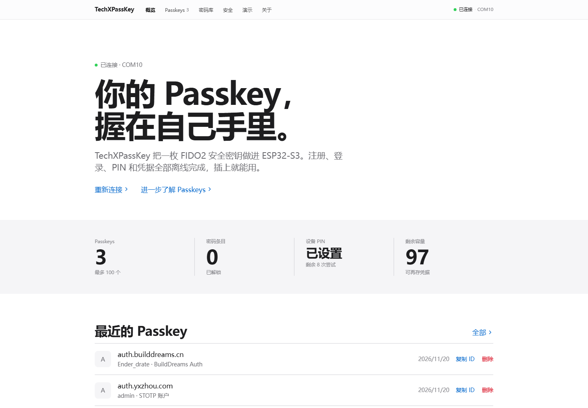
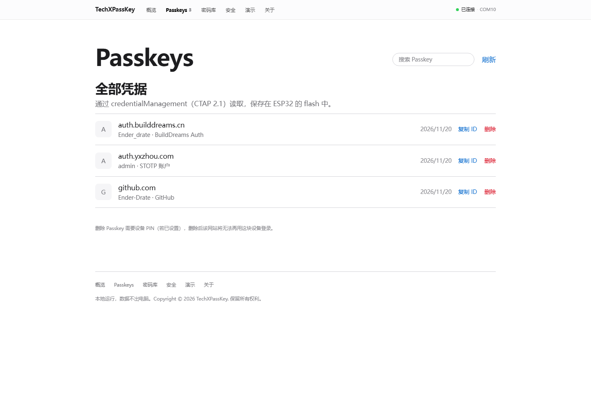
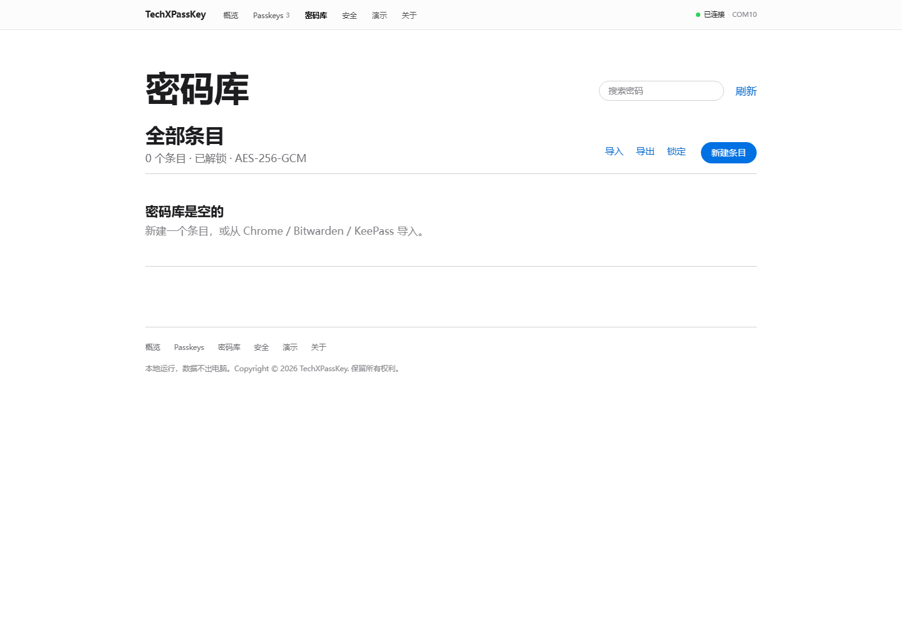
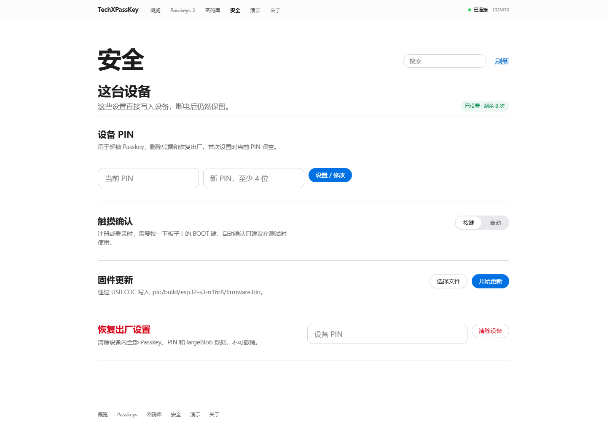

# TechXPassKey

一块 **ESP32-S3** 做成的 FIDO2 物理 Passkey，加上一套本地凭据 / 密码管理器，
以及一个通过 BLE 管理设备的 Android App。

- **固件**：CTAP 2.1 / CTAP1(U2F) / PIN 协议 1&2 / 常驻凭据 / credentialManagement /
  largeBlobs / OTA，USB HID + BLE 双传输。
- **管理器**：Python 后端 + apple.com.cn 风格的本地 Web UI；加密密码库、
  TOTP、导入导出、Passkey 列表与删除、PIN、OTA、WebAuthn 演示。
- **Android**：BLE 伴生 App，扫描连接、设备信息、PIN 设置/修改、凭据列表与删除。



## 仓库结构

```
firmware/          ESP32-S3 固件（PlatformIO / Arduino）
manager/           本地管理器（Python + Web UI）
android/           Android BLE 伴生 App（Java）
docs/              使用说明与截图
scripts/           pkdev.py（管理协议）、flash_passkey.ps1、serial_capture.py
tests/             CTAP2 / U2F / credMgmt / largeBlob / PIN 持久化 / BLE 测试
tools/webauthn-demo/  独立 WebAuthn 演示服务器
```

## 快速开始

### 1. 烧录固件

```bash
pio run -d firmware
pio run -d firmware -t upload --upload-port COM8
```

只接了原生 USB 时：按住 **BOOT** → 点一下 **RST** → 松开，然后
`powershell -File scripts/flash_passkey.ps1`。

### 2. 启动管理器

```bash
python manager/server.py
# 打开 http://localhost:8787
```

首次进入「密码库」会要求设置主密码（scrypt + AES-256-GCM，仅存本机）。
「安全」页可以设置设备 PIN、切换触摸确认模式、OTA 更新固件。

### 3. Android App

APK 在本仓库的 **Releases** 中下载；也可以本地构建：

```bash
cd android
./gradlew assembleDebug
# app/build/outputs/apk/debug/app-debug.apk
```

App 通过 BLE 连接设备（服务 `0xFFFD`），读取设备信息、设置/修改 PIN、
列出并删除凭据。删除凭据需要设备 PIN（若已设置）。

## 支持的能力

| 能力 | 状态 |
|---|---|
| CTAP2.1 makeCredential / getAssertion | ✅ Chrome / Windows 实测 |
| CTAP1 / U2F register / authenticate | ✅ |
| clientPIN 协议 1 & 2 | ✅ |
| 常驻凭据（Passkey） | ✅ |
| credentialManagement（枚举 / 删除） | ✅ |
| largeBlobs | ✅ |
| OTA（USB CDC） | ✅ |
| 断电保存 PIN / 凭据 / 计数器 | ✅ |
| BLE CTAP（CBOR + U2F） | ✅ Android App / bleak 实测 |
| hmac-secret / credBlob / largeBlobKey | 未实现（未广告） |

## 设计

管理器按 **apple.com.cn** 的视觉语言实现：48px 半透明顶部导航、超大标题、
大面积留白、发丝线分隔、无卡片无阴影，颜色只保留灰阶与单一蓝色强调。
结构上参考 `apple-design-skill` 的克制原则，去掉了深色侧栏、卡片和渐变。

| Passkeys | 密码库 | 安全 |
|---|---|---|
|  |  |  |

## 安全模型

- 设备端主密钥保存在 NVS；PIN 只存 `AES-GCM(masterKey, SHA256(pin)[:16])`；
  常驻凭据私钥在 flash 中；non-resident 凭据用 AES-GCM 包裹。
- 管理器只监听 `127.0.0.1`，主密码不落盘，锁定后内存密钥丢弃。
- 导出文件为明文，请自行保管。
- 触摸确认使用板载 BOOT 键；「自动确认」仅建议测试时使用。

## 测试

```bash
python tests/ctap_test.py        # PIN + makeCredential + getAssertion（CDC）
python tests/protocols_test.py   # U2F + credMgmt + largeBlob
python tests/pin_persist.py      # 重启后 PIN / 凭据保留
python tests/ble_ctap_test.py    # BLE（需 -DPK_BLE_ALIAS=1 构建）
```

## 已知限制

- 未实现 `hmac-secret` / `credBlob` / `largeBlobKey`。
- `credProtect` 只接受输入、不回显（Windows 解析兼容问题）。
- Windows 的 FIDO 栈独占 BLE `0xFFFD`：Windows 浏览器正常，但通用 GATT
  工具看不到该服务；BLE 自动化测试用 `-DPK_BLE_ALIAS=1` 映射到 `0xFFF0`。
- Android App 只做管理，不替代系统的 WebAuthn 选择器。

## License

MIT
