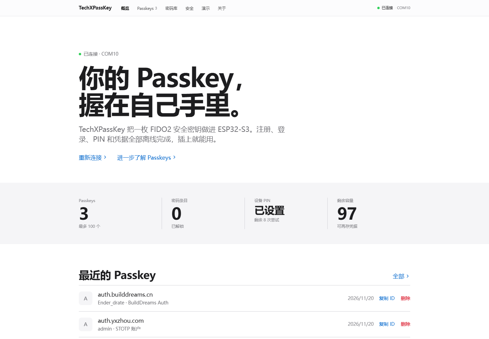
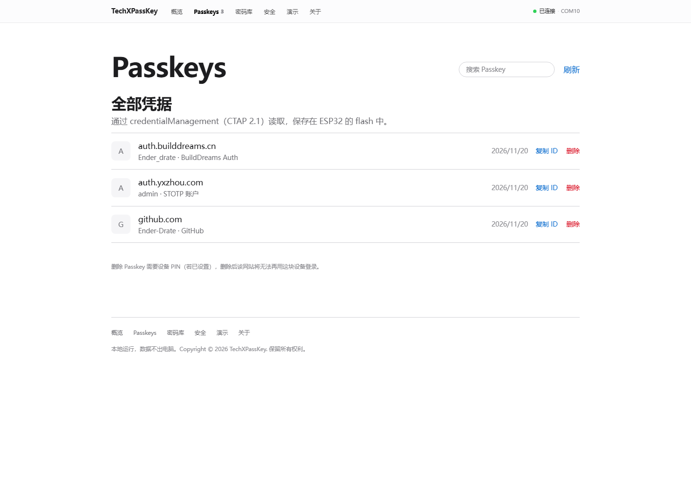
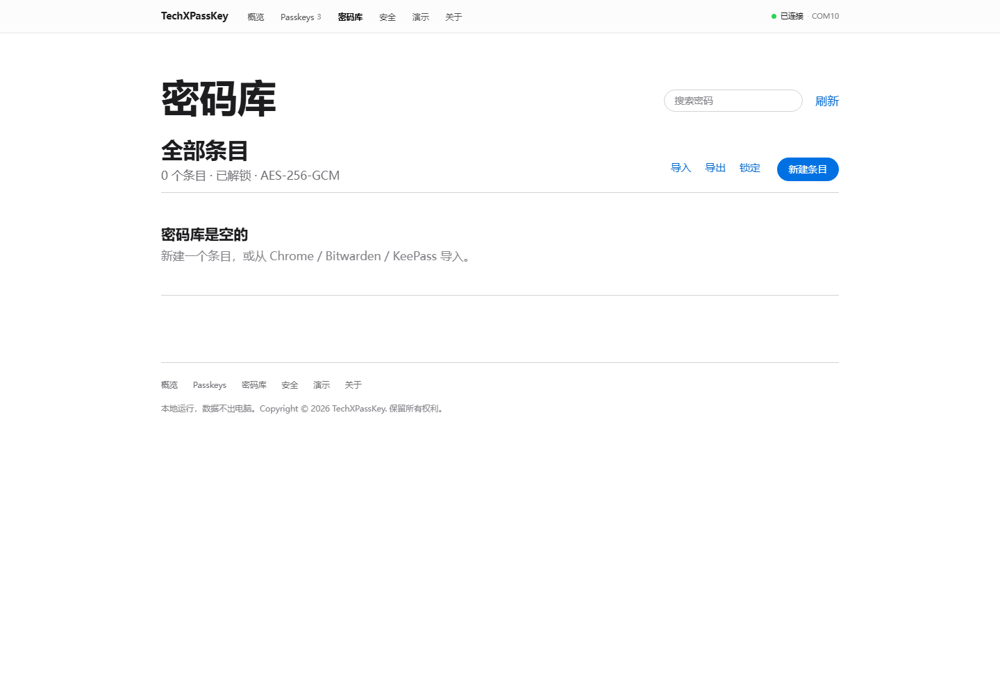
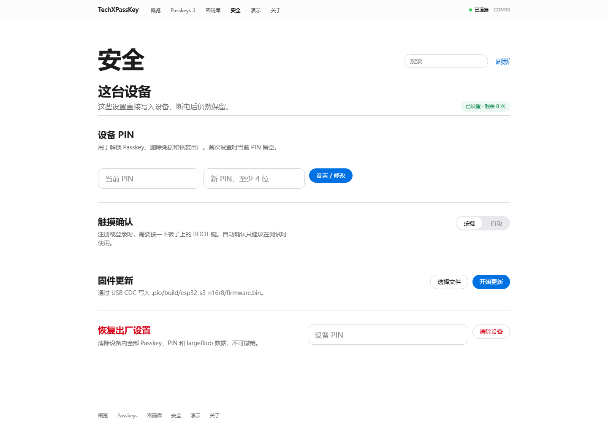

# TechXPassKey — ESP32 物理 Passkey + 凭据/密码管理器

一块 **ESP32-S3-N16R8** 做成真正的 FIDO2 安全密钥（USB HID + BLE），外加一个
Apple 风的本地管理器（Passkey 列表 / 删除 / PIN / OTA / 加密密码库 / TOTP /
WebAuthn 演示）。



## 快速开始

```powershell
# 1) 打开管理器（会自动打开 http://localhost:8787）
.\apps\passkey-manager\start.bat

# 2) 固件（已烧录；改动后重新烧）
.\scripts\pio.ps1 run -d .\projects\passkey -t upload --upload-port COM8
```

- 设备通过 **CH343 UART（COM8）** 烧录，通过 **原生 USB（CDC + HID）** 工作。
- 浏览器注册：管理器「演示」页 → 注册 Passkey → 选择 **TechXPassKey** →
  按一下板子上的 **BOOT**。
- 设备 PIN：在管理器「安全」页设置（初始未设置）。删除 Passkey、恢复出厂
  会要求 PIN。

## 已经验证的能力

| 能力 | 验证方式 |
|---|---|
| Chrome/Windows WebAuthn 注册 + 登录 | 现场实测（attestation=none，flags 0x45/0x5） |
| CTAP2.1 makeCredential / getAssertion | python-fido2 + 签名校验 |
| CTAP1/U2F register / authenticate | 签名 + 计数器校验 |
| clientPIN 协议 1 & 2 | setPIN / changePIN / getToken |
| credentialManagement | 枚举 RP/凭据、删除、元数据 |
| largeBlobs | 写入 → 读回 → 哈希校验 |
| authenticatorConfig | alwaysUv / minPINLength |
| OTA（USB CDC） | 436 KB 固件写入 + 重启 + 数据保留 |
| 断电保存 | 重启后 PIN/凭据/计数器仍在 |
| BLE CTAP | bleak：getInfo + PIN + makeCredential + getAssertion 全通过 |

## 目录

```
projects/passkey/            固件（Arduino + TinyUSB + Bluedroid）
apps/passkey-manager/        管理器（Python 后端 + Apple 风 Web UI）
  server.py                  HTTP API / 静态文件 / WebAuthn 校验
  core/vault.py              scrypt + AES-256-GCM 密码库
  core/totp.py               TOTP/HOTP
  core/importers.py          CSV/JSON 导入导出
  web/                       前端（无框架）
scripts/pkdev.py             设备管理协议客户端（INFO/OTA/凭据/PIN…）
scripts/flash_passkey.ps1    只接原生 USB 时的烧录脚本（BOOT+RST）
tests/                       ctap_test / protocols_test / pin_persist / ble_ctap_test
docs/screenshots/            UI 截图
```

## 界面

| Passkeys | 密码库 | 安全 |
|---|---|---|
|  |  |  |

设计：按 **apple.com.cn** 的视觉语言——48px 半透明顶部导航、超大标题、
大面积留白、发丝线分隔、无卡片无阴影，颜色只保留灰阶与单一蓝色强调；
结构上沿用 apple-design-skill 的克制原则，去掉了深色侧栏、卡片和渐变。

## 协议细节

- **USB**：复合设备，HID（usage page `0xF1D0`，64 字节报告，CTAPHID）+
  CDC（管理帧 `A5 5A | ver | cmd | seq | len | payload | crc16`）。
- **CTAP2.1**：getInfo / makeCredential / getAssertion / getNextAssertion /
  clientPIN / reset / credentialManagement / selection / largeBlobs / config。
- **CTAP1**：U2F 原始 APDU（短/扩展长度），attestation 证书内嵌。
- **BLE**：FIDO GATT `0xFFFD`，`CMD/HLEN/LLEN` + `SEQ` 分帧，CBOR `0x90` /
  MSG `0x83` / PING `0x81` / KEEPALIVE `0x82`。
- **存储**：NVS（主密钥、PIN 哈希、设置、计数），LittleFS（`/creds.bin`、
  `/blob.bin`），双 3 MB OTA 槽。

## 测试

```powershell
python tests/ctap_test.py        # PIN + 注册 + 断言（CDC）
python tests/protocols_test.py   # U2F + credMgmt + largeBlob
python tests/pin_persist.py      # 重启后 PIN/凭据保留
python tests/ble_ctap_test.py    # BLE（需 -DPK_BLE_ALIAS=1 构建）
```

## 安全模型

- 设备端 PIN 只存 `AES-GCM(masterKey, SHA256(pin)[:16])`，masterKey 在 NVS；
  它只保护 PIN 校验，不直接保护凭据私钥。
- 凭据库 `/creds.bin` 是 **PKC2 密文**：随机 DEK 做 AES-256-GCM；DEK 又被副板的
  **KEK** 包裹后存 NVS。KEK 只在副板，主板不保存。开机时副板证明 link key 后，
  用 link key 加密把 KEK 发给主板，主板解出 DEK 才能把凭据解密到 RAM。
  只拿主板 + flash dump 得到的是密文和 `AES-GCM(KEK, DEK)`，没有副板解不开。
- non-resident 凭据（U2F/rk=false）的 key handle 也用 DEK 包裹；升级前的旧
  handle 仍可用 masterKey 解开（兼容路径）。
- 管理器：密码库 `scrypt(N=2^15) + AES-256-GCM`，主密码不落盘；只监听
  `127.0.0.1`；导出为明文，需自行保管。
- 触摸确认：BOOT 键；管理器可切「自动确认」但仅建议测试时使用。
- **仍未启用 ESP32-S3 Flash Encryption / Secure Boot**。因此拿到主板的人虽然
  解不开凭据，仍可刷入自己的固件（然后必须再拿到副板才能取 KEK）；要防刷机/
  防 flash 读取，需要另开 eFuse 安全启动与加密。

## 第二块板（物理钥匙）

主板 GPIO16/17 与副板 GPIO41/42 两线 UART 相连，副板保存 32 字节 link key。
主板只有在持续收到副板的 HMAC 证明时才允许注册/登录；否则红灯并返回
`CTAP2_ERR_OPERATION_DENIED`。

```
主板 GPIO16 (TX) ──→ 副板 GPIO42 (RX)     推荐交叉
主板 GPIO17 (RX) ←── 副板 GPIO41 (TX)
GND ─────────────── GND
```

直连接法（`16→41`、`17→42`）也能用：主板每 6 秒自动交换 RX/TX，直到配对成功。

- 上电自动配对：主板生成 key → 空副板保存 → 之后每 700 ms 一次 nonce/HMAC 心跳。
- **配对是一次性的**：第一次成功后主板不再静默分发 key；换副板用管理器
  「更换副板」——旧副板先验证，再插新板，pending key 原子切换，**Passkey 不清空**；
  超时/取消保留旧 key。
- 2.5 秒没有有效证明：红灯，`makeCredential` / `getAssertion` / U2F 全部拒绝。
- **PIN 仍保存在主板**，电脑端输入；副板只是额外的物理因子，不存 PIN。
- 副板丢失：主板恢复出厂（触摸）会清凭据和 link key，再配新副板；副板上电时
  按住 BOOT 3 秒可清 key。

副板固件：`firmware-key/`；管理器「安全 → 第二块板」会显示连接状态。

## 已知限制

- 未实现 `hmac-secret` / `credBlob` / `largeBlobKey`（未广告）。
- `credProtect` 只接受输入、不回显（Windows 解析兼容问题）。
- Windows 的 FIDO 栈独占 BLE `0xFFFD`：Windows 浏览器正常，但通用 GATT
  工具看不到它；BLE 自动化测试用 `-DPK_BLE_ALIAS=1` 映射到 `0xFFF0`。
- 首次烧录若只接原生 USB：按住 BOOT → 点 RST → 松开，再
  `.\scripts\flash_passkey.ps1`。
