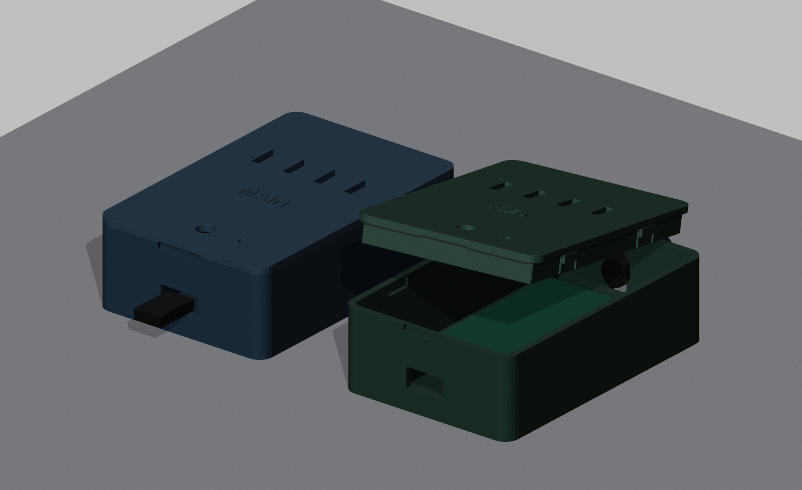
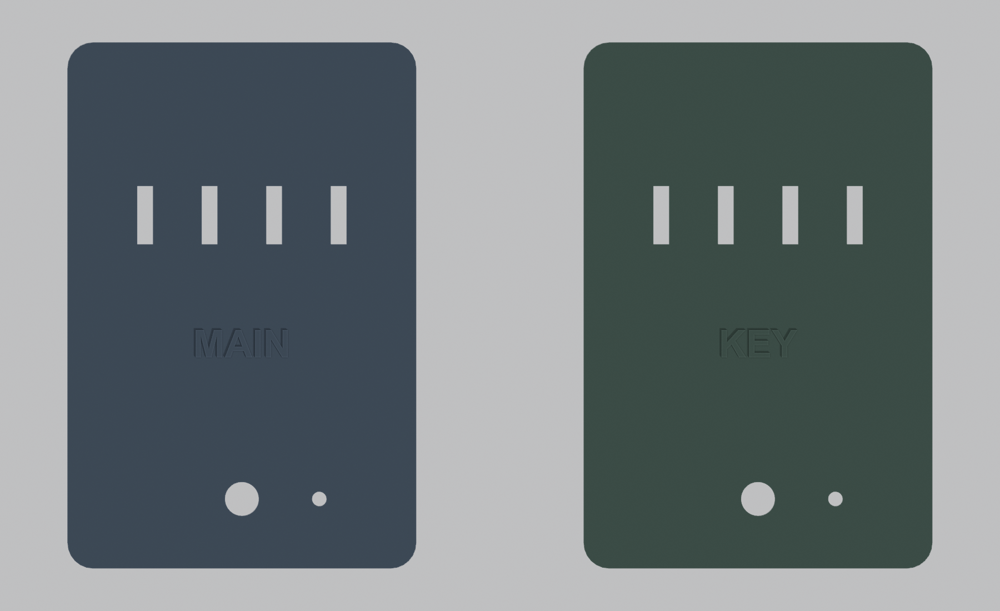

# TechXPassKey 外壳（Blender MCP 生成）

两个 3D 打印外壳：**主板 MAIN**（深海军蓝）和 **副板 KEY**（墨绿）。
外框尺寸按面包板 **54.1 × 81.6 mm**，总高 26 mm（含盖；盖面字凸起约 0.3 mm）。
盖子用 **4 个卡扣 + 前缘撬槽**，不用螺丝，可以直接压紧、撬开。

## 文件

| 文件 | 说明 |
|---|---|
| `main_base.stl` | 主板底壳，54.10 × 81.60 × 24.00 mm |
| `main_lid.stl` | 主板盖，卡沿/卡扣/散热槽/MAIN 字，高 8.30 mm |
| `key_base.stl` | 副板底壳，与主板底壳几何相同 |
| `key_lid.stl` | 副板盖，卡沿/卡扣/KEY 字 |
| `techxpasskey_enclosures.blend` | 可编辑 Blender 源文件 |
| `build_enclosures.py` | 通过 Blender MCP 执行的生成脚本 |
| `preview.png` | 主板装好 + 副板爆炸预览 |
| `preview_exploded.png` | 两个都爆炸的预览 |
| `preview_top.png` | 盖面俯视，检查散热槽/按键孔/字样 |

四个 STL 都经过网格检查：**非流形边 0、边界边 0、孤点 0**。

## 关键尺寸

- 外形：**54.10 × 81.60 mm**，装配总高 **26.30 mm**
- 底壳高 24.00 mm；盖高 8.30 mm（卡沿 6 + 盖板 2 + 字 0.3）
- 壁厚 2.0 mm，底板 2.0 mm，盖板 2.0 mm，外角 R4
- 内部净空：50.1 × 77.6 mm
- **USB-C 开口**：12 × 6 mm，位于 −Y 短边，中心高 9.5 mm
- **DC 头过孔**：Ø8.0 mm 圆孔 + 5.6 mm 宽钥匙槽，开口到底部；位于 +Y 短边，
  中心高 14 mm。按常见 5.5 × 2.1 mm DC 头留了约 2.5 mm 余量（“大一圈”）
- 板轨：两条 2 mm 宽导轨从底板长到 z=10，间距 **25.6 mm**（适配 25.4 mm 宽的
  ESP32-S3 DevKit），带 1.4 mm 压边和 +Y 端挡块
- **卡扣**：长边两侧各 2 个，共 4 个；每个是 8.4 mm 宽、6 mm 长的弹性卡舌，
  1.5 mm 厚，外侧 0.9 mm 凸点卡进底壳内壁 1.1 mm 深的凹槽
- **撬槽**：−Y 前缘 14 mm 宽、约 2 mm 高的缺口，指甲/塑料撬片可插入
- 盖面：4 条 2.4 × 9 mm 散热槽、BOOT 按键 Ø5.2、RST 针孔 Ø2.2

## 打印建议

- 材料：**PETG 优先**（卡扣需要韧性）；PLA 也能用，但拆装次数少
- 层高 0.2 mm，4 圈墙，20% gyroid，底/顶 4–5 层
- **底壳**：底面朝下，无需支撑；USB/DC 开口和导轨都是竖直面
- **盖**：盖面朝上、卡沿朝下打印，无需支撑；卡舌与盖沿一体成型
- 卡扣配合偏紧时，用砂纸轻磨凸点或凹槽 0.1–0.2 mm；偏松时在凹槽里贴一层
  0.2 mm 胶带

## 装配

1. 把主板/副板从 −Y（USB）端滑进两条板轨；USB-C 连接器对准 12×6 开口。
2. 先插好 USB 和 DC 线，再把线从 DC 钥匙孔理出。
3. 对准盖沿，四角依次按压，听到/感觉到 4 个卡扣“咔”一下即可。
4. 打开：在 −Y 前缘的撬槽插入指甲或塑料撬片，向上轻撬；不要用金属螺丝刀
   硬撬卡扣位置。
5. 主板用 MAIN 盖，副板用 KEY 盖；颜色和字样都能区分。

## 适配说明

- 板宽按 25.4 mm（ESP32-S3-DevKitC-1）设计，导轨间隙 25.6 mm；更宽的板需要
  把压边和导轨各向外移 0.5–1 mm。
- BOOT/RST 孔位按“USB 在同一端”的常见 DevKit 布置；如果你的板子按键在另一端，
  把板子旋转 180° 装机，或直接在 `.blend` 里移动这两个孔。
- DC 孔按 5.5 mm 外径 DC 头设计；更大的头（5.5×2.5、6.0 mm）把 Ø8 改成 Ø9 即可。
- 卡扣是按 0.9 mm 凸点 / 1.1 mm 凹槽设计的；如果 PETG 收缩导致偏松，可把凸点
  加到 1.0–1.1 mm。

## 重新生成

`techxpasskey_enclosures.blend` 可直接改尺寸后重新导出 STL。
生成脚本通过 Blender MCP（`mcp-for-blender` + Blender 5.2.1 GUI）的
`execute_blender_code` 执行：bmesh 建圆角盒、布尔开孔、卡扣、导出 STL 和渲染。
